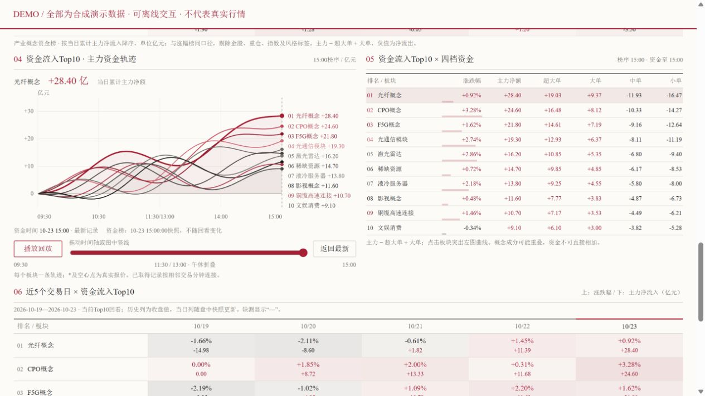
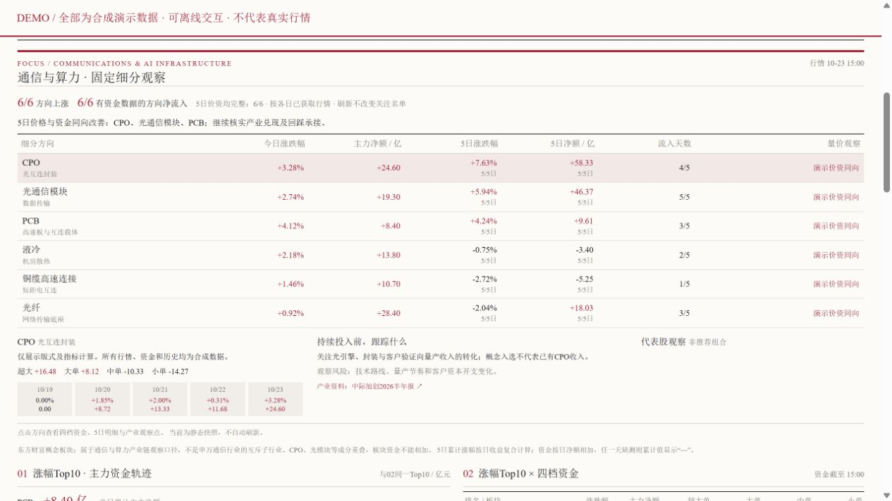

# A股产业轮动看板

**涨幅 Top10 × 主力净流入 Top10 × 通信与算力细分观察。**

一个在本机运行的 A 股复盘与盘中观察工具。用同一套版式展示市场宽度、产业主题、资金轨迹和国内外快讯，并把每天收盘时的界面保存成独立 HTML。



> 本页配图和 `examples/demo.html` 全部使用合成演示数据。真实运行时显示各数据源的原始时间；延迟、缓存和缺测会明确标注。

## 看什么

| 区块 | 内容 | 排名口径 |
| --- | --- | --- |
| 市场宽度 | 近30个交易日涨跌家数、6个主要指数与分时 | 公开行情及本机已积累历史 |
| 通信与算力 | CPO、光模块、PCB、液冷、铜缆、光纤 | 固定观察池，独立于每日排名 |
| 01 / 02 / 03 | 主力资金轨迹、四档资金、5日矩阵 | 当日涨幅 Top10 |
| 04 / 05 / 06 | 主力资金轨迹、四档资金、5日矩阵 | 当日累计主力净流入 Top10 |
| 07 | 国内外宏观与市场快讯 | 各自发布时间与来源 |

01/04资金图支持鼠标悬停高亮：靠近曲线或右侧标签时，该曲线加粗、其他曲线淡化，并显示板块名称和当前回放时点的资金净额；移开恢复。原有拖动时间轴与播放回放保留。

两榜使用同一产业主题范围，排除金股、重仓、指数和风格标签。CPO、F5G、PCB等是东方财富概念口径，成分可能重叠；它们不是互斥的申万行业，资金不能跨概念直接相加。

## 先看演示

下载项目后，双击 [examples/demo.html](examples/demo.html)。演示已内嵌图表库，支持板块选择和时间轴回看，不请求行情，也不要求启动 Python 服务。



## 运行真实看板

需要 Python 3.10+；测试使用 Python 3.12。推荐 Windows，其他系统可使用命令行。

Windows：先双击 `安装依赖.cmd`，完成后双击 `启动实时看板.cmd`。

也可以在项目根目录执行：

```bash
python -m pip install -r requirements.txt
python workspace/scripts/launch_dashboard.py
```

浏览器地址为 `http://127.0.0.1:8765/`。仅供本机访问。关闭浏览器后后台服务继续运行，重启电脑后需重新启动。

服务每60秒检查行情，快讯约每5分钟检查一次。“检查频率”不等于数据源更新频率；公开接口可能延迟、限流或暂时不可用。首次启动没有本机缓存，30日市场宽度历史需要逐日积累；不会用模拟值补齐。周末、节假日与盘前按已核验交易日历对应最近交易日。

## 保存每天的收盘界面

后台服务在交易日15:00之后保存第一份界面：

```text
收盘数据/YYYY-MM-DD/收盘看板.html
```

文件内嵌当时的数据、版式和图表库，打开后不自动刷新，已有HTML不会覆盖。保存时若有延迟或缺测，也会保留原始状态；它是“当时的看板”，不保证每个源都已返回最终收盘值。电脑需开机、服务需运行。

手动保存：

```bash
python workspace/scripts/closing_archive.py
```

Windows可双击 `保存收盘看板.bat` 手动归档，或双击 `安装收盘定时任务.bat`，安装每周一至周五北京时间15:00运行的本机任务。需要Windows时区为北京时间、电脑开机且用户已登录，无需Codex。脚本优先复用现有看板服务；未启动服务时自行采集。BAT优先使用项目的 `.venv`，其次使用 `py -3` 或PATH中的Python。

任务名为 `AshareIndustryDashboard_ClosingHTML`。重复安装只更新同一目录的任务；若同名任务属于其他目录则停止。启用错过计划后补跑，但补跑保存的是实际运行时的界面，不能还原错过的15:00。日志在 `workspace/cache/closing_archive-task.log`。辅助JSON归档用于缓存恢复，日常查看HTML即可。

## 自动同步代码到GitHub

需要Git以及对origin仓库有写权限的登录，可通过Git Credential Manager登录。脚本使用本机Git认证，不保存token，也不依赖Codex。

在Git克隆目录双击 `启动GitHub自动同步.bat`，后台每3秒检查一次，修改停止30秒后自动提交并推送当前分支；`立即同步GitHub.bat`在后台监视未运行时执行一次。只监视已被Git跟踪的代码与说明，新文件需先明确加入Git。缓存、收盘数据、生成的实时页面和日志不参与同步。

远端更新只允许快进；遇到冲突、认证失败或网络问题会记录错误并稍后重试，不强制覆盖远端。同一目录重复启动会保留已有后台实例，避免重复提交。关闭终端不影响后台进程；重启后需重新启动，或自行加入Windows登录任务。日志和最新状态分别在 `workspace/cache/github-sync.log` 与 `workspace/cache/github-sync-status.json`。

开发者本机的发布工程还支持 `workspace/release/publish-files.json` 白名单：通过已有发布构建器输出可移植代码，再同步至独立Git目录。该模式若检测到远端新增提交会暂停发布，需先与本机源文件核对合并。该模式的公开说明源位于 `workspace/release/`；不会把整个私人工作目录直接推上GitHub。

## 修改与检查

- 关注方向和代表股：`workspace/data/communications_watch.json`。
- 版式源文件：`workspace/templates/dashboard.html`。
- 双榜交互：`workspace/scripts/dashboard.js`；资金回看：`fund_replay.js`。
- 数据适配、排名过滤、缓存：`live_data.py`；通信观察：`communications_data.py`。

修改后构建：

```bash
python workspace/scripts/build_preview.py
```

构建只依赖本项目与Python库，不要求Codex。`dashboard.fragment.html`、`snapshot.html`、缓存和收盘数据均为运行产物，已从Git排除。

验证：

```bash
python workspace/scripts/build_preview.py
python -m unittest discover -s workspace/scripts -p "test_*.py"
node workspace/scripts/test_fund_replay.cjs
```

最后一项需要Node.js；它用于开发测试，运行看板无需Node.js。

## 目录

```text
ashare-industry-dashboard/
├─ README.md / DATA_SOURCES.md      使用与数据口径
├─ requirements.txt               Python依赖
├─ 安装依赖.cmd / 启动实时看板.cmd
├─ 保存收盘看板.bat / 安装收盘定时任务.bat
├─ 启动GitHub自动同步.bat / 立即同步GitHub.bat
├─ examples/demo.html              合成数据离线演示
├─ docs/images/                    演示截图
└─ workspace/
   ├─ scripts/                     数据、服务、构建与测试
   ├─ templates/                   版式源文件
   ├─ data/                        固定观察池、交易日历
   ├─ vendor/                      D3及其许可证
   └─ cache/                       本机运行后产生，不上传
```

## 数据与限制

详见 [DATA_SOURCES.md](DATA_SOURCES.md)。主力净流入采用供应商的超大单加大单分类，不代表“机构真实仓位”。仅连接真实观测点；缺少整分钟的轨迹保留断点，不从日涨幅反推资金。两榜可独立回看；榜单源暂时失联时保留原名单并标出时间，资金记录可独立补取。

代码采用 [MIT许可证](LICENSE)。D3单独保留ISC许可证。行情、新闻和公司披露的权利归各来源方；代码许可证不授予第三方数据的再分发权。此项目用于信息整理与技术学习，不构成投资建议。
